# Subaru Dashboard (SSM, K-Line / CAN)

Приложение для Android-магнитол (Teyes и подобных): бортовой компьютер, приборы, расход топлива, ошибки двигателя и АКПП для Subaru с протоколом **SSM2 по K-Line** через дешёвый **USB KKL-кабель**.

Сделано и проверено на **Subaru Forester SG5 2003 (JDM, EJ20 turbo, 4EAT)** с Android-магнитолой **Teyes CC3** (Android 10, 1280×720), установленной вместо штатной. Должно работать и на других Subaru 2001–2008 с SSM2 по K-Line (Forester SG, Impreza GD/GG, Legacy BE/BH/BL/BP), но там не проверялось.

| Главная | Динамика |
|---|---|
|  |  |
| **Расход** | **АКПП** |
|  |  |
| **Аккумулятор** | **Ошибки** |
|  |  |

## 🧪 Бета 0.9 (для тестов)

Отдельная тестовая версия: [Releases](https://github.com/surtaeff/subaru-ssm-dashboard/releases), помечена как pre-release. Ставится поверх 0.9-beta1…beta6, данные сохраняются. Бета подписана другим ключом, чем 0.8: перед установкой удалите 0.8 (поездки и заправки удалятся).

> **[⬇️ Скачать 0.9-beta7](https://github.com/surtaeff/subaru-ssm-dashboard/releases/download/v0.9-beta7/subaru-ssm-dashboard-0.9-beta7.apk)** · [что нового](https://github.com/surtaeff/subaru-ssm-dashboard/releases/tag/v0.9-beta7) · [руководство (PDF)](docs/manual-ru.pdf)

### Новое в 0.9-beta7

Всё новое выключается в **Настройки → «Функции»**, если кому-то не нужно.

| Замеры разгона | G-метр и крен на выбранной 3D-модели |
|---|---|
| 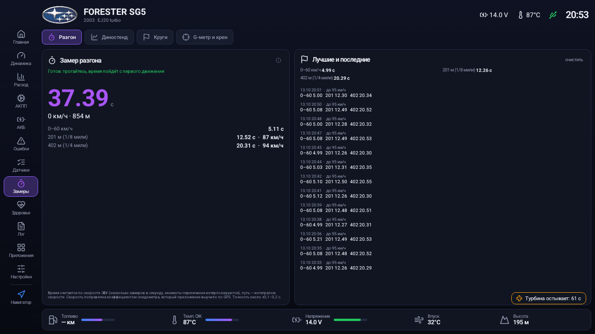 | 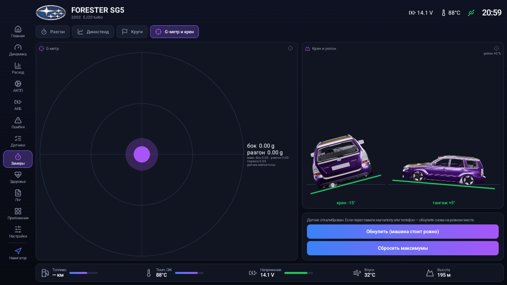 |
| **Турботаймер** | **Настройки → «Функции»** |
| 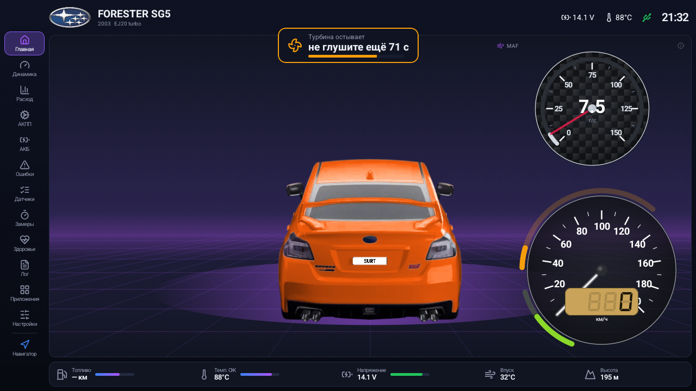 | 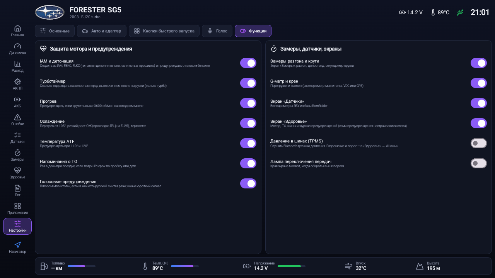 |

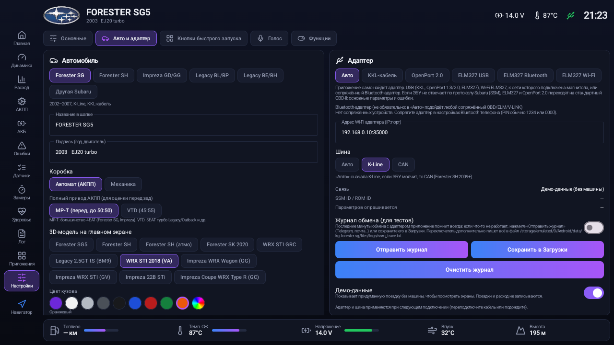

- **3D-модели.** Добавлены Forester SK, Legacy BM9, WRX STI 2018 и GRC, Impreza Wagon GG и STI GV, 22B, купе GC.
  - Добавлены атмо-версии Forester SG5 и SH без воздухозаборника на капоте.
  - SG5 переделана: тонированные стёкла, ровная посадка, штатный бампер, любой цвет кузова.
  - Машина на ходу не крутится пальцем, а при возврате на Главную сразу стоит задом.

- **Защита мотора:**
  - IAM и коррекции по детонации FBKC/FLKC по базе RomRaider, с предупреждением о плохом бензине;
  - история IAM по поездкам, рядом последняя заправка;
  - перегрев ОЖ;
  - резкий рост температуры ОЖ на прогретом моторе: на EJ25 это признак прокладки ГБЦ или воздуха в системе;
  - термостат: время прогрева, «не прогревается»;
  - ATF выше 110 и 120°.
- **Турботаймер и прогрев.** После нагрузки приложение подсказывает, сколько подождать на холостых, а на холодном масле — «не выше 3000». Температура масла берётся из ЭБУ, а если её там нет, оценивается.
- **Предупреждения** баннером поверх любого экрана и голосом (русский синтез речи магнитолы, без него — сигнал). Есть журнал предупреждений.
- **Экран «Замеры»:**
  - разгон 0–60, 0–100, 0–150, 0–200, 201 и 402 м с конечной скоростью;
  - на ходу 60–100, 80–120, 100–200;
  - «диностенд»: мощность и момент на колёсах по оборотам, по массе и ускорению;
  - секундомер кругов по GPS;
  - G-метр и крен/тангаж.
- **G-метр и крен.** Источник выбирается сам:
  - акселерометр магнитолы, если он есть, с обнулением на ровном месте;
  - датчик VDC (SH и новее);
  - GPS и скорость.
  
  Уклон дороги считается по высоте GPS.
- **Экран «Здоровье»:** мотор, план ТО, шины, журнал предупреждений.
  - План ТО под EJ: масло, ремень ГРМ, свечи, фильтры, ATF, редуктор, антифриз, тормозная жидкость.
  - Пробег считается от введённого одометра плюс поездки. Напоминание раз в день.
- **Давление в шинах** от недорогих Bluetooth-датчиков TPMS (TPMS1…TPMS4): предупреждения о низком давлении и медленной утечке.
- **Лампа переключения передач** с настраиваемым порогом.
- **Новые карточки** для Главной и «Динамики»:
  - G-метр, крен, IAM и детонация, наддув «цель / факт», пики поездки, разгон, турбина и масло, шины, ближайшее ТО;
  - «Датчик 1…6» — любой параметр, отмеченный на экране «Датчики».
- **Исправления:**
  - поле номера на 3D-модели открывало цифровую клавиатуру;
  - в учёт поездок и расход больше не попадают явно ошибочные данные (обороты выше 10 000, скорость выше 300 км/ч);
  - параметры, которых ЭБУ не поддерживает, больше не показывают мусор (на EJ253 было «коррекция детонации 63,5°»);
  - турботаймер показывается крупно вверху по центру и только у турбо-машин.

### Новое в 0.9-beta6

| Все параметры ЭБУ (база RomRaider) | Адаптер «Авто» и журнал |
|---|---|
| 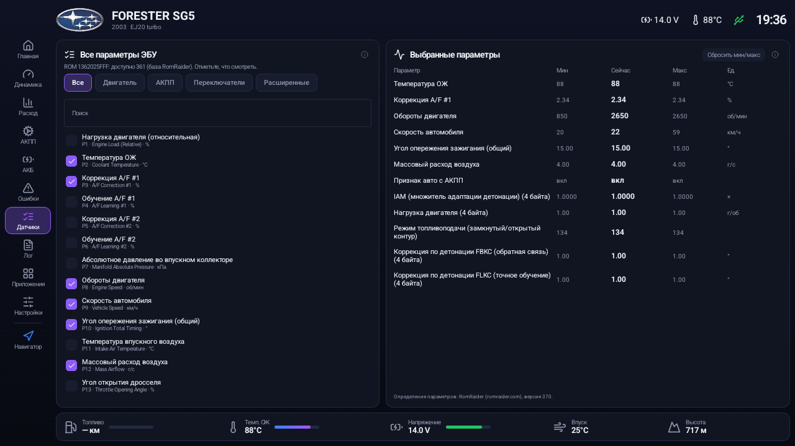 | 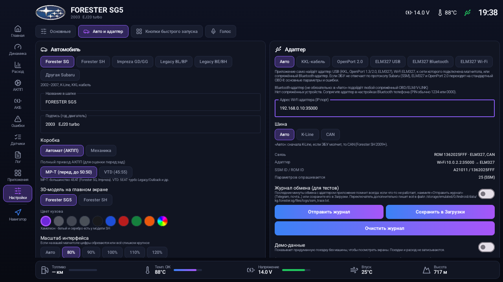 |

- **Адаптер «Авто»** (теперь по умолчанию): приложение само находит, что подключено.
  - По USB: KKL, OpenPort 1.3 или 2.0, ELM327 с USB-шнуром. ELM определяется по ответу на AT-команды.
  - Wi-Fi ELM327, если магнитола подключена к его сети.
  - Сопряжённый Bluetooth-адаптер.
  - Выбирать вручную больше не нужно, но ручной выбор остался.
- **ELM327 по USB и по Wi-Fi** в дополнение к Bluetooth.
- **Стандартный OBD-II.** Если ЭБУ не отвечает по протоколу Subaru (SSM), ELM327 и OpenPort 2.0 переходят на OBD-II.
  - Показываются основные параметры: обороты, скорость, температуры, ДМРВ, дроссель, напряжение, коррекции, уровень топлива.
  - Ошибки читаются и сбрасываются стандартными командами.
  - Так приложение работает почти с любой машиной с OBD-II, но без АКПП и детонации.
- **Экран «Датчики»: все параметры ЭБУ, как в RomRaider или EcuExplorer.** Встроена база RomRaider v370:
  - 245 стандартных параметров (двигатель и АКПП) и 172 переключателя: показывается то, что ЭБУ заявляет при подключении;
  - 204 расширенных параметра (IAM, коррекции по детонации FBKC/FLKC, целевой наддув…) с адресами для 605 прошивок, по ROM ID;
  - отмеченные параметры показываются с текущим значением, минимумом и максимумом и пишутся в CSV-лог дополнительными колонками;
  - названия переведены на русский.
- **Коды ошибок:** таблица дополнена из той же базы, теперь 587 кодов вместо 387.
- **«Отправить журнал».** Последние минуты обмена с адаптером приложение помнит всегда, даже с выключенным журналом.
  - Одной кнопкой журнал отправляется в Telegram или почту либо сохраняется в «Загрузки».
  - В начало журнала автоматически добавляются модель магнитолы, версия Android, настройки и список USB-устройств, в том числе нераспознанных.
- **Исправления ELM327:**
  - ответы больше не сдвигаются: раньше, если адаптер отвечал медленно, каждая команда получала ответ на предыдущую;
  - ответ «OK» вместо данных больше не обрывает связь.

### Новое в 0.9-beta5

- KKL-кабели со своим чипом внутри (например, VAG K+CAN Commander) пропускают K-Line только при определённых уровнях линий DTR/RTS. Если ЭБУ молчит, приложение теперь по очереди пробует все четыре варианта. Вариант, который сработал, виден в строке связи и в журнале обмена.

### Новое в 0.9-beta4

- Поддержка кабеля **Tactrix OpenPort 1.3** (M/S/U): раньше приложение его не видело. Работает как KKL-кабель по K-Line.

### Новое в 0.9-beta3

| Главная в стиле NFS Most Wanted | Дизайны мини-карты |
|---|---|
| 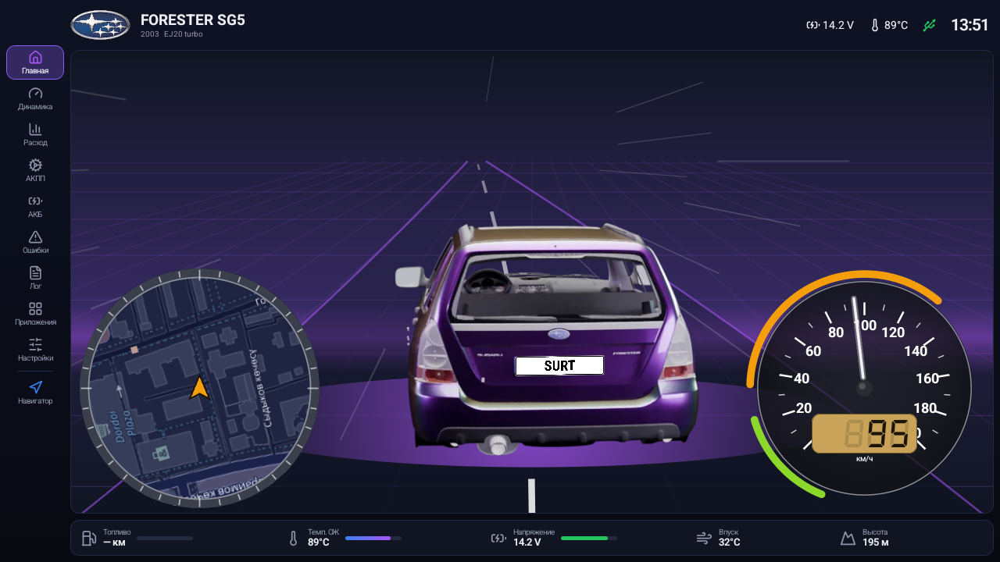 | 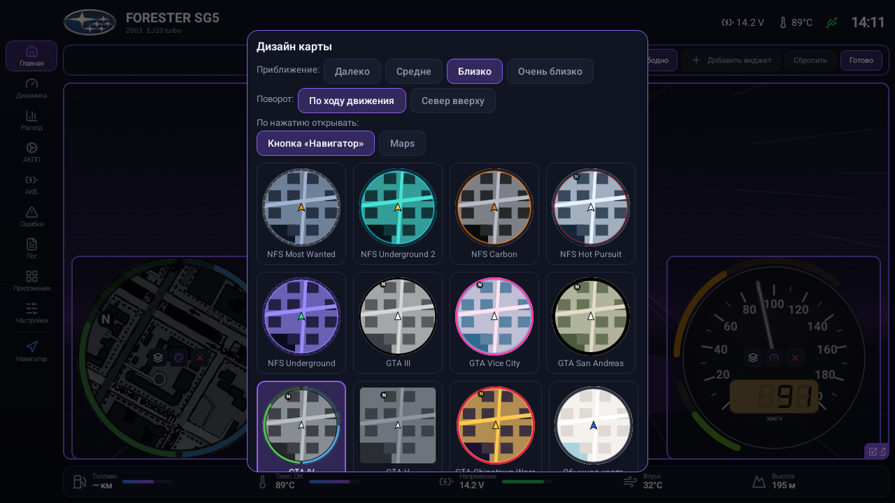 |
| **Карта GTA San Andreas** | **Карта GTA V** |
| 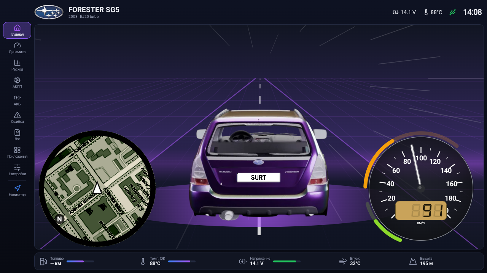 | 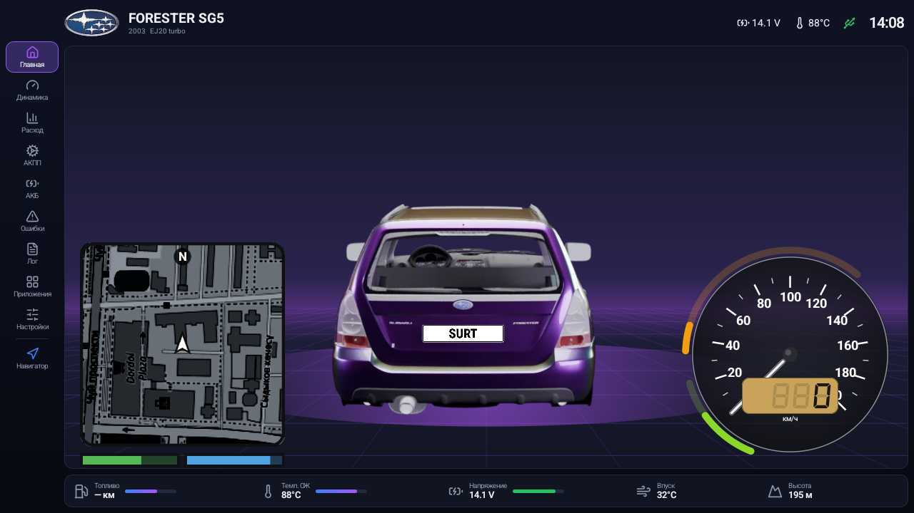 |

- **Резервная копия** (Настройки → Основные): «Сохранить копию…» и «Восстановить из файла…» — поездки, заправки, калибровка, раскладки экранов, свои дизайны и настройки в одном zip-файле. Плюс **автокопия раз в сутки** в `Download/SubaruDashboard` (последние 7): эта папка остаётся даже после удаления приложения, так что данные переживут любую переустановку.
- **Мини-карта** (добавляется на главную): карта вокруг машины по GPS, повёрнута по ходу движения, нажатие открывает навигатор. 12 дизайнов в стиле игр: NFS Most Wanted, Underground, Underground 2, Carbon, Hot Pursuit, GTA III, Vice City, San Andreas, IV, V, Chinatown Wars и обычная карта. В GTA IV и V полоски «жизни» и «брони» со значками колонки и батарейки показывают остаток топлива и напряжение, их можно скрыть. Дизайн, приближение и «север вверху» выбираются долгим нажатием на карту. Карта своя (OpenStreetMap): встроить карту Яндекса или Google Android не позволяет. Нужен интернет, увиденные места потом видны и без сети.
- **Какое приложение открывает карта** — Настройки → Основные → «Мини-карта открывает» или в окне дизайна карты: кнопка «Навигатор» или любой установленный навигатор (Яндекс Навигатор, Яндекс Карты, Google Карты, 2ГИС, Waze, OsmAnd…).
- **Прибор «Рокпорт»** в стиле NFS Most Wanted: дымчатый циферблат, ЖК-табло, оранжевая дуга показывает обороты, зелёная — остаток топлива. Дуги вокруг прибора живые у всех дизайнов, где они есть.
- **3D-машина в свободной раскладке** всегда лежит под остальными виджетами, а её размер меняется кнопками «лупа − / +» (от 30 до 100 %), не меняя размер виджета.

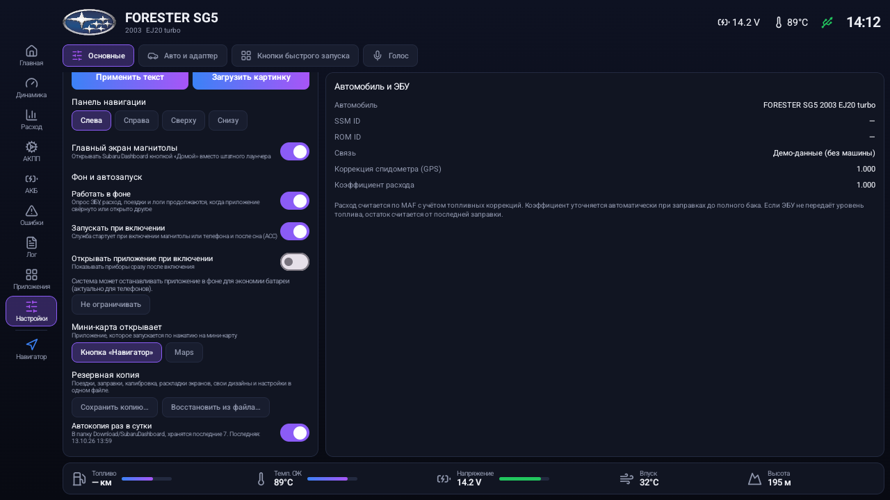

### Было в 0.9-beta2

| Приборы на главной | Свободное размещение |
|---|---|
| 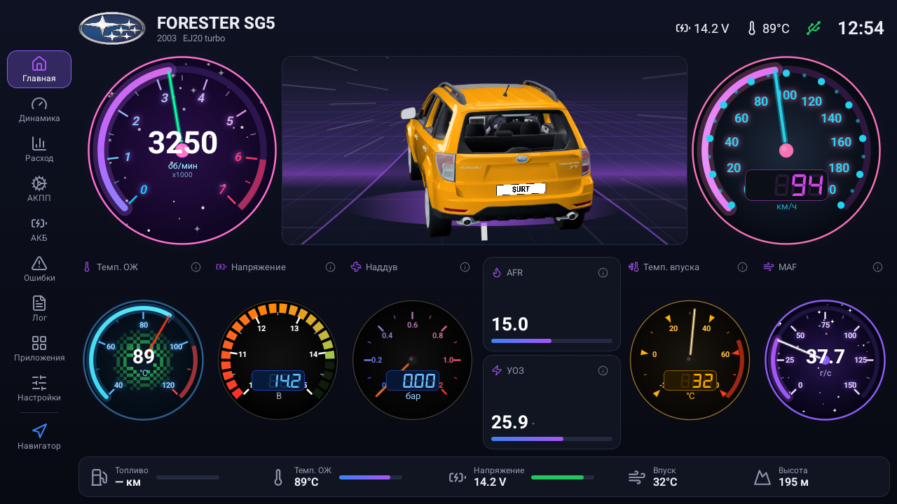 | 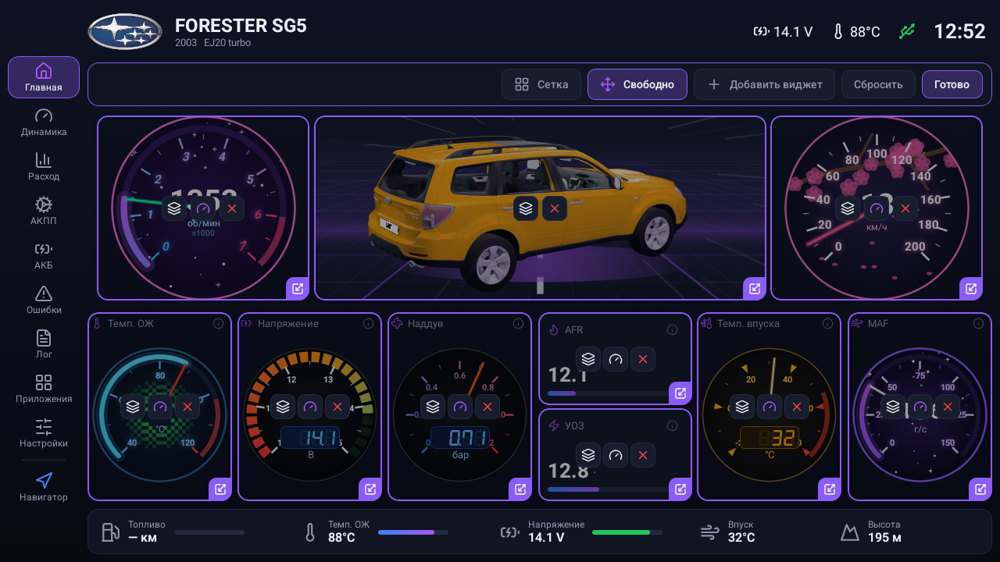 |
| **77 дизайнов приборов** | **Свой дизайн** |
| 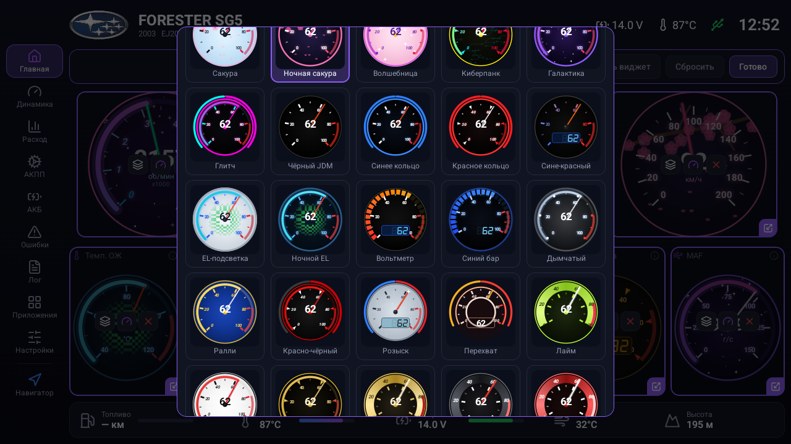 | 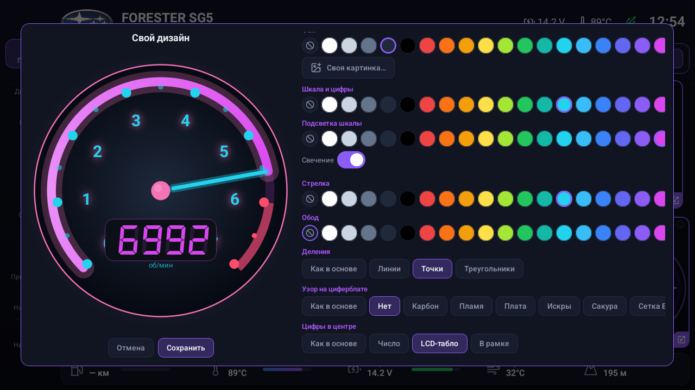 |
| **«Динамика» со стрелками** | **Подсказка «i»** |
| 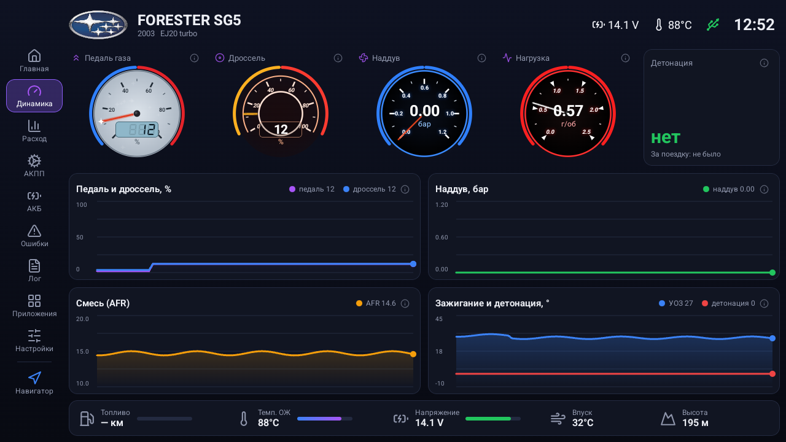 | 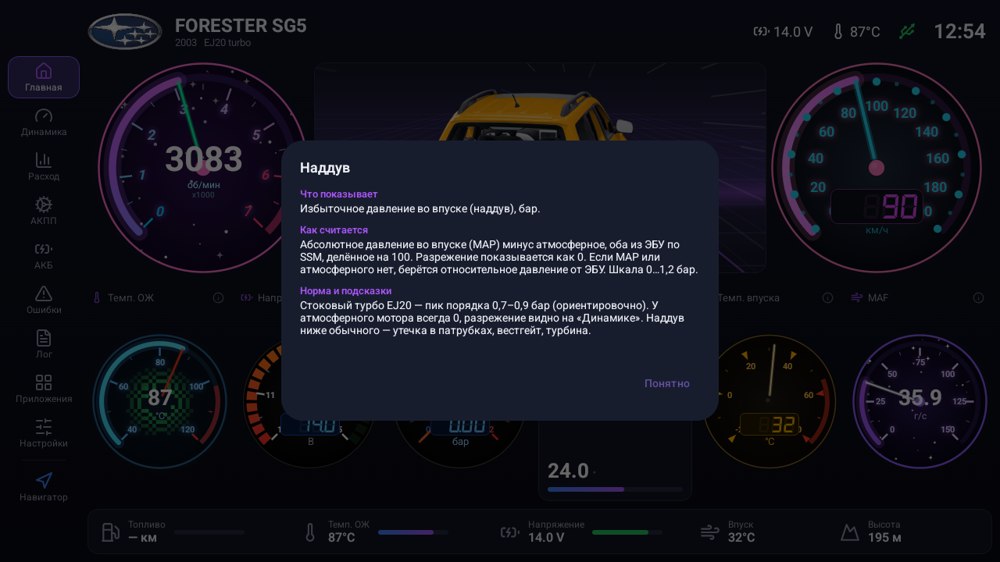 |

- **Любой виджет — стрелочный прибор.** В режиме редактирования (долгое нажатие на виджет) кнопка с прибором переключает вид: обычный или стрелка в одном из 77 дизайнов. Есть неон и аниме-стиль (Вейпорвейв, Синтвейв, Сакура, Ночная сакура, Киберпанк, Токио…), JDM-приборы (Чёрный JDM, Синее и Красное кольцо, Сине-красный, EL-подсветка, Вольтметр с LED-сегментами), приборы из NFS Underground 2 / Most Wanted / Hot Pursuit (LCD, Пламя, Плата, Хром, Котик, Погоня…), классика, LCD и LED-бары.
- **Свой дизайн.** В том же окне «Свой дизайн…»: основа из любого дизайна, цвета фона, шкалы, подсветки, стрелки и обода, свечение, форма делений (линии, точки, треугольники), узор (карбон, пламя, плата, искры, сакура, EL-сетка, synthwave, звёзды), цифры числом, LCD-табло или в рамке.
- **Своя картинка на циферблате**, например аниме-арт: «Своя картинка…» в окне выбора дизайна, картинка обрезается в круг, шкала поверх подсвечивается неоном.
- **Свободное размещение.** В режиме редактирования переключатель «Сетка / Свободно»: виджет перетаскивается куда угодно, размер меняется за угол, кнопка со слоями поднимает его поверх других. На главной 3D-машина, тахометр и спидометр становятся отдельными виджетами, их тоже можно двигать, увеличивать, убирать и класть друг на друга.
- **«Динамика» и «АКПП» настраиваются** так же, как главная: убрать, добавить, переставить, изменить размер. Новые виджеты: обороты, графики оборотов, коррекций A/F, MAF, оборотов турбины и скорости колёс.
- **Подсказка «i» у каждого виджета**: что показывает, откуда берётся и как считается, какие значения нормальны. Всё это собрано и в [руководстве (PDF)](docs/manual-ru.pdf).
- **Детонация по-новому**: случаи считаются за поездку и только от отката 1° и глубже, под счётчиком самый глубокий откат, по нажатию список случаев с оборотами, нагрузкой и скоростью, всё пишется в `logs/knock.csv`.
- **Фон и автозапуск** (Настройки → Основные): «Работать в фоне» (опрос, расход и логи идут, когда приложение свёрнуто), «Запускать при включении» (в том числе после сна магнитолы по ACC) и «Открывать приложение при включении» (Android попросит разрешение «Поверх других приложений»).

### Было в 0.9-beta1

- Приложение называется **Subaru Dashboard** (обновление встаёт поверх Forester SG, данные сохраняются).
- **Настройки → «Авто и адаптер»**: модель (Forester SG/SH, Impreza, Legacy…), подпись в шапке, коробка (автомат/механика), 3D-модель Forester SG5 или SH и цвет кузова (у SH любой цвет из палитры, включая белый и серебро), масштаб интерфейса. При первом запуске приложение само спрашивает модель, коробку и адаптер (по умолчанию SG5 + KKL).
- **Bluetooth OBD (ELM327)** (β): для телефонов. CAN работает (SH 2009+ и новее), K-Line только у оригинальных ELM327 v1.4+ (клоны чаще не умеют). Сопрягите свисток в настройках Bluetooth телефона и выберите его в «Авто и адаптер».
- **Адаптер OpenPort 2.0** (Tactrix и китайские клоны, USB `0403:CC4C`): K-Line и **CAN** (Forester SH 2009+ и другие машины, где SSM идёт по CAN). Шина: «Авто» (сначала K-Line, потом CAN), K-Line или CAN.
- **Другие ЭБУ (например, евро SH 2008 по KKL):** если ЭБУ не отвечает на полный список параметров, приложение опрашивает только то, что ЭБУ поддерживает (по байтам возможностей), или подбирает параметры по одному.
- **Журнал обмена**: включите в настройках, если не работает, и пришлите файл `Android/data/kg.forester.sg/files/logs/ssm_trace.txt`.
- **Демо-данные**: придуманная поездка без машины, чтобы посмотреть экраны.
- **Главный экран**: тахометр и спидометр вокруг 3D-машины; на ходу вид сзади, дорога и повороты по GPS, эффекты скорости, огонь и турбо из выхлопа. На стоянке машина не крутится, её можно повернуть пальцем.
- **Дизайн приборов** в духе NFS Underground: нажмите и удерживайте тахометр или спидометр и выберите стиль (Неон, Underground, Кислота, STI, Белая классика, Карбон, Ретро, Минимал), у каждого прибора свой.
- **Свой главный экран**: нажмите и удерживайте любой виджет (или карандаш на 3D-блоке): виджеты можно убирать, добавлять, менять ширину и порядок, 3D-блок сделать больше или скрыть. «Сбросить» возвращает как было.
- **Телефон**: полный интерфейс как на магнитоле, горизонтально, масштаб подгоняется под экран.
- **Уровень топлива по датчику**: если ЭБУ отдаёт датчик уровня (у SG5 его нет), приложение учится пересчитывать показание датчика в литры по заправкам и затем показывает остаток «по датчику».
- **Расход точнее**: в режиме обогащения расход считается по замеренному AFR без повторного учёта коррекций; байт AFR не используется, если у ЭБУ нет широкополосного датчика; калибровка по заправкам ограничена (от 20 л, коэффициент 0,7–1,4), «убежавший» коэффициент старых версий сбрасывается на 1,0; мгновенный л/100 показывается от 20 км/ч, ниже — л/ч; поездки корректно разделяются, графики без всплесков, сутки по местному времени.
- **Оценка перед:зад** на экране АКПП (β): по проценту муфты, для MP-T или VTD; нужна проверка на живых логах (в CSV добавлены `transfer_pct` и скорости колёс).

## 📥 Скачать APK

**[⬇️ Скачать subaru-ssm-dashboard.apk](https://github.com/surtaeff/subaru-ssm-dashboard/releases/latest/download/subaru-ssm-dashboard.apk)** (последняя версия, собирать ничего не нужно)

Все версии: [Releases](https://github.com/surtaeff/subaru-ssm-dashboard/releases).

**Как установить на магнитолу (без компьютера):**
1. Скачай APK по ссылке выше на телефон или компьютер.
2. Скопируй файл на флешку и вставь её в USB магнитолы. Можно и иначе: открой эту страницу в браузере на самой магнитоле и скачай APK прямо туда.
3. На магнитоле открой «Файлы» (File Manager), найди `subaru-ssm-dashboard.apk` и нажми на него.
4. Если появится «Установка из неизвестных источников запрещена», нажми «Настройки», разреши установку для файлового менеджера (или браузера) и вернись назад.
5. Нажми «Установить», затем «Открыть».
6. Разреши доступ к местоположению.
7. Подключи KKL-кабель (см. ниже). На вопрос «Открыть приложение при подключении USB-устройства?» поставь галочку «по умолчанию» и нажми «ОК».
8. Включи зажигание или заведи двигатель: данные пойдут через пару секунд.

> Обновление: просто установи новый APK поверх старого, данные (поездки, заправки, калибровка) сохранятся.

## Что умеет

**Двигатель (ЭБУ, SSM2-адрес 0x10)**, опрос около 4 раз в секунду:
- обороты, скорость, температура ОЖ и впуска, напряжение бортсети;
- MAF, дроссель, педаль газа, привод электронного дросселя, длительность и загрузка форсунок;
- наддув (абсолютное давление во впуске минус атмосферное), wastegate, AVCS;
- AFR (широкополосный A/F-датчик), краткосрочная и долгосрочная топливная коррекция;
- угол зажигания и откат по детонации: случаи за поездку (откат от 1° и глубже), самый глубокий откат, список с оборотами и нагрузкой, журнал `logs/knock.csv`;
- предупреждения цветом: перегрев, низкое напряжение, большие коррекции.

**АКПП (TCU, SSM2-адрес 0x18):**
- положение селектора (P/N, R, D, 3, 2, 1) и текущая передача;
- температура ATF с зонами «холодная / норма / горячая / перегрев»;
- обороты турбины, блокировка гидротрансформатора и проскальзывание;
- давление в линии, муфта полного привода (transfer duty), скорость передних и задних колёс.

**Расход топлива:**
- мгновенный (л/100 км и л/ч), за поездку, за всё время;
- считается по MAF с учётом топливных коррекций и замеренного AFR;
- самокалибровка по заправкам: вводишь только «сколько залил», дата подставляется сама, коэффициент уточняется между заправками до полного бака;
- запас хода, остаток в баке, стоимость поездки;
- график динамики (10 мин, час, сегодня, неделя), расход по режимам (город, трасса, смешанный), история за 30 дней, список поездок, оценка стиля вождения.

**Аккумулятор:**
- напряжение покоя и примерный процент заряда;
- просадка при пуске стартером и длительность пуска;
- напряжение заряда от генератора и загрузка генератора;
- оценки «норма / слабый / недозаряд / перезаряд»;
- история за сутки и неделю, журнал событий (дублируется в `logs/battery.csv`).

**Ошибки:**
- чтение и сброс кодов отдельно для двигателя (387 кодов) и для АКПП (Subaru 2-значные или OBD-II коды, таблица выбирается автоматически по ответу блока);
- текущие ошибки и ошибки в памяти;
- описания кодов на русском, под ними оригинал на английском.

**Кнопки быстрого запуска и разделённый экран:**
- кнопки «Навигатор» и «Музыка» в боковой панели, свои кнопки добавляются в «Настройках» (любое установленное приложение, название, иконка Lucide, режим «рядом» или «весь экран»);
- «рядом»: приложение открывается в левой половине экрана, а Subaru Dashboard справа перестраивается в компактную панель водителя (скорость, обороты, АКПП, наддув, температуры, напряжение, расход);
- кнопка «Весь экран» возвращает полноэкранный режим, навигатор продолжает вести по маршруту в фоне;
- разделённый экран на Teyes открывается через root (Magisk). Без root кнопки просто запускают приложение.

**Голосовой ассистент (офлайн):**
- своё имя ассистента (по умолчанию «Форестер»), команды: кнопки по названию или голосовой фразе, «поехали на …» (поиск в Яндекс Навигаторе), «весь экран», «громче/тише», «следующий/далее/пауза/стоп/играй», открыть экраны («расход», «коробка», «аккумулятор», «ошибки»);
- распознавание Vosk, модель ~45 МБ скачивается один раз; микрофон должен быть свободен (на Teyes отключите Teyes Voice / TXZ).

**Панель навигации** — слева, справа, сверху или снизу (Настройки).

**Главный экран магнитолы:**
- приложение можно назначить домашним экраном вместо лаунчера Teyes (Настройки → «Главный экран магнитолы», нужен root);
- вкладка «Приложения»: все установленные программы, поиск и кнопка «Штатный лаунчер Teyes»;
- после перезагрузки режим восстанавливается скриптом Magisk (`/data/adb/service.d/forester_home.sh`).

**3D-модель Forester SG на главной:**
- 72 кадра поворота на 360° (крутится пальцем, медленный автоповорот, подсветка в такт оборотам), цвет «баклажан-хамелеон»;
- свой номер: Настройки → «Номер на 3D-модели» (текст или своя картинка, например фото своего номера с флагом) — номер накладывается на табличку с перспективой;
- кадры отрендерены скриптом `render/render_turntable.py` (Blender 4.2).

**Медиа (замена виджетов Teyes, только на магнитолах FYT — Teyes и подобных):**
- штатный плеер: трек, исполнитель, прогресс, управление (данные приходят от плеера, когда приложение — главный экран);
- Bluetooth-музыка и FM-радио через системную службу FYT (`com.syu.ms`): частота, пресет, название станции и логотип из онлайн-списка Teyes (`/sdcard/fmbd`), поиск и пресеты.

**Прочее:**
- GPS: высота, контроль спидометра (коэффициент коррекции учится по GPS), пробег;
- CSV-лог каждой поездки со всеми параметрами;
- автоочистка: подробные логи хранятся 1, 3 или 7 суток, папка не больше 200 МБ, данные графиков сжимаются и хранятся 35 дней;
- фоновый сервис: данные пишутся, даже когда открыт навигатор;
- автостарт при загрузке магнитолы и при подключении кабеля.

## Что нужно

### Магнитола
Android-магнитола (Teyes CC3/CC2/SPRO, FYT/UIS7862 и подобные) или планшет с **USB host**, Android 8.0+ (minSdk 26). Интерфейс рассчитан на экран 1280×720 в горизонтальной ориентации.

Root **не нужен**. Он используется только по желанию: на Teyes CC3 USB-контроллер иногда застревает в режиме device, и с root приложение само возвращает его в host.

### Кабель или адаптер
В настройках оставьте **«Авто»**, и приложение само определит адаптер.

| Адаптер | Что умеет |
|---|---|
| **USB KKL-кабель** («VAG-COM KKL 409.1», «USB KKL OBD2»; чипы CH340/CH341, FTDI FT232, PL2303, CP210x) | SSM по K-Line: все параметры, ЭБУ и АКПП. Лучший вариант для машин до ~2008 г. (проверено на `1a86:7523`) |
| KKL со своим чипом (VAG K+CAN Commander и подобные) | То же. Приложение само подбирает уровни DTR/RTS |
| **Tactrix OpenPort 1.3** (M/S/U, `0403:CC48`–`CC4A`) | Как KKL-кабель |
| **Tactrix OpenPort 2.0** и клоны (`0403:CC4C`) | SSM по K-Line и CAN (SH 2009+), иначе стандартный OBD-II по CAN |
| **ELM327** (USB, Bluetooth, Wi-Fi) | SSM по CAN (SH 2009+). SSM по K-Line только у оригинальных ELM327 v1.4+, клоны обычно не умеют. Если SSM не отвечает, работает стандартный OBD-II: основные параметры и ошибки |

USB-драйверы: [usb-serial-for-android](https://github.com/mik3y/usb-serial-for-android). Если адаптер не определился, нажмите **Настройки → «Авто и адаптер» → «Отправить журнал»**. В журнале будут USB-коды кабеля и весь обмен с ним.

### Подключение
- Кабель втыкается в 16-контактный диагностический разъём под рулём; K-Line это **контакт 7**.
- На некоторых машинах есть отдельные зелёные разъёмы «Test mode / Read memory», для SSM они **не нужны**: просто подключи кабель к основному разъёму.
- Параметры линии: 4800 бод, 8N1. Все запросы эхом возвращаются в кабель, приложение это учитывает.

## Сборка из исходников (для разработчиков)
```bash
# JDK 17 + Android SDK (platform 34)
./gradlew assembleDebug
adb install -r app/build/outputs/apk/debug/app-debug.apk
```

## Как это работает
- **Протокол SSM2:** пакет `80 <dest> F0 <len> <cmd…> <checksum>`, где `0xBF` это init (SSM ID, ROM ID, байты возможностей), `0xA8` чтение адресов, `0xB8` запись.
- **Список параметров** проверяется по байтам возможностей ЭБУ. Адреса и формулы взяты из логгер-определений RomRaider и таблиц FreeSSM.
- **Положение селектора АКПП** (байт `0x6B`) определено опытным путём на 4EAT: бит 1 R, бит 2 D, бит 3 «3», бит 4 «2», бит 5 «1», ноль P/N.
- **Уровень топлива** ЭБУ SG5 не передаёт (параметр `0x2E` не поддерживается), поэтому остаток считается от заправок.
- **Сброс ошибок:** запись `0x40` по адресу `0x000060`. Сбрасывает и адаптации (топливные коррекции, обучение детонации и холостого хода, у АКПП обучение переключений). После сброса выключи зажигание на 5–10 секунд.

## Благодарности и источники данных
- [RomRaider](https://www.romraider.com/): логгер-определения SSM v370 (параметры, переключатели, расширенные параметры по ROM ID, коды ошибок), GPL. Исходный файл и генератор лежат в `tools/romraider/`, русские названия в `tools/romraider/ru/`;
- [FreeSSM](https://github.com/Comer352L/FreeSSM): таблицы параметров и ошибок ЭБУ и АКПП, таблица температуры ATF, GPL-3.0;
- [usb-serial-for-android](https://github.com/mik3y/usb-serial-for-android): драйверы USB-serial, MIT;
- [Lucide](https://lucide.dev/) через [composables icons-lucide](https://github.com/composablehorizons/compose-icons): иконки, ISC.

## 3D-модели
Forester SH: [«Subaru Forester 2009»](https://sketchfab.com/3d-models/925112ae29514dcf89ccf2fc7020338e) автора **niev** (Sketchfab), лицензия [CC BY 4.0](https://creativecommons.org/licenses/by/4.0/). Изменения: перекрашено, затемнён салон, пустые номерные таблички (`render_turntable.py --fix sh`, упаковка `render/pack_frames.py`).

Forester SH (атмо): та же модель [«Subaru Forester 2009»](https://sketchfab.com/3d-models/925112ae29514dcf89ccf2fc7020338e) автора **niev** (Sketchfab), лицензия [CC BY 4.0](https://creativecommons.org/licenses/by/4.0/). Изменения: как у SH, плюс убран воздухозаборник на капоте (атмо-версия) (`render_turntable.py --fix shna`).

Forester SG: кадры отрендерены из модели [«Subaru Forester MK2 2002-2008»](https://sketchfab.com/3d-models/subaru-forester-mk2-2002-2008-1df01538f1954a5c87adcc4a792a365a) автора **szymonpasterczyk** (Sketchfab), лицензия [CC BY 4.0](https://creativecommons.org/licenses/by/4.0/). Изменения: убраны тюнинг-детали и салон мода, вместо тюнингового бампера поставлен штатный передний бампер из комплекта модели, капот выровнен по кузову, колёса собраны на штатных ступицах в размере стоковых шин (машина стоит ровно, на заводской высоте), добавлены тонированные стёкла (в модели их нет), затемнена внутренняя сторона кузова, перекрашено, пустые номерные таблички (`render_turntable.py --fix sg`).

Forester SG5 (атмо): та же модель [«Subaru Forester MK2 2002-2008»](https://sketchfab.com/3d-models/subaru-forester-mk2-2002-2008-1df01538f1954a5c87adcc4a792a365a) автора **szymonpasterczyk** (Sketchfab), лицензия [CC BY 4.0](https://creativecommons.org/licenses/by/4.0/). Изменения: как у SG, плюс убран воздухозаборник на капоте (атмо-версия) (`render_turntable.py --fix sgna`).

Остальные модели отрендерены так же, как SH (кадры с краской «хамелеон», белый кузов и маска кузова, поэтому доступен любой цвет): `render/render_models.sh` → `render_turntable.py --fix <id>` → `render/pack_frames.py`. У всех приведены масштаб (метры) и ориентация, номерные знаки заменены пустыми табличками, стёкла заменены тонированными; кузов перекрашивается целиком, поэтому заводские ливреи и наклейки, нарисованные на текстуре кузова, пропадают.

- Forester SK 2020: [«2020 Subaru Forester»](https://sketchfab.com/3d-models/2020-subaru-forester-611ae23685c14134b5a4f3decde248e9) автора **tonielpro520**, лицензия [CC BY 4.0](https://creativecommons.org/licenses/by/4.0/). Изменения: модель в дюймах приведена к метрам, филиппинские номера заменены пустыми табличками, хрому и стёклам фар возвращён блеск (в файле все материалы матовые).
- WRX STI GRC: [«subaru wrx sti grc»](https://sketchfab.com/3d-models/subaru-wrx-sti-grc-560b949e9d5b4642ad9debbe89fa1b43) автора **amogusstrikesback2**, лицензия [CC BY 4.0](https://creativecommons.org/licenses/by/4.0/). Изменения: убраны «лучи» фар и плоскости свечения фонарей, антенна на крыше, гоночная ливрея заменена краской; передней таблички нет (у оригинала её нет).
- Legacy 2.5GT tS (BM9): [«2010 Subaru Legacy 2.5GT tS (BM9)»](https://sketchfab.com/3d-models/2010-subaru-legacy-25gt-ts-bm9-ac37399c27e64c7c940dad5aca0a567c) автора **ilvskf**, лицензия [CC BY 4.0](https://creativecommons.org/licenses/by/4.0/). Изменения: затемнён салон, добавлены пустые номерные таблички.
- WRX STI 2018 (VA): [«2018 Subaru WRX STi»](https://sketchfab.com/3d-models/2018-subaru-wrx-sti-211e549af05c449a932b977dda0b0654) автора **OUTPISTON**, лицензия [CC BY-NC-SA 4.0](https://creativecommons.org/licenses/by-nc-sa/4.0/). Изменения: убрана служебная сфера окружения, применена скелетная деформация, затемнён салон, задняя табличка Subaru заменена пустой, добавлена передняя.
- Impreza WRX Wagon (GG): [«Subaru WRX Wagon (GG)»](https://sketchfab.com/3d-models/subaru-wrx-wagon-gg-fa2c8e1d265443e982b90f964c2b3e02) автора **ilvskf**, лицензия [CC BY 4.0](https://creativecommons.org/licenses/by/4.0/). Изменения: добавлены пустые номерные таблички.
- Impreza WRX STI (GV): [«subaru impreza wrx sti special edition»](https://sketchfab.com/3d-models/subaru-impreza-wrx-sti-special-edition-52e2cdb39ce9410ca7b9c291f0bb53b9) автора **amogusstrikesback2**, лицензия [CC BY 4.0](https://creativecommons.org/licenses/by/4.0/). Это седан 2011–2014 (GV) с широким обвесом. Изменения: убраны «лучи» фар, наклейки и рисунок-ливрея (перекрашиваются двери, задние крылья, крышка багажника и крыша; обвес, бамперы и карбоновый капот остаются чёрными), добавлена передняя табличка.
- Impreza 22B STi: [«1998 Subaru Impreza 22B STi»](https://sketchfab.com/3d-models/1998-subaru-impreza-22b-sti-c61e9130c0124374a53d2eb37ca5dcc9) автора **VTX**, лицензия [CC BY-NC-SA 4.0](https://creativecommons.org/licenses/by-nc-sa/4.0/). Изменения: модель в масштабе 1:100 приведена к метрам, добавлены пустые номерные таблички.
- Impreza Coupe WRX Type R (GC): [«Subaru Impreza Coupe WRX Type R STi»](https://sketchfab.com/3d-models/subaru-impreza-coupe-wrx-type-r-sti-757ef77568f54339aa524d3b03437890) автора **vecarz**, лицензия [CC BY-NC-SA 4.0](https://creativecommons.org/licenses/by-nc-sa/4.0/). Изменения: японские номера заменены пустыми табличками, непрозрачная плёнка на лобовом стекле заменена тонированным стеклом.

Кадры моделей WRX STI 2018 (VA), Impreza 22B STi и Impreza Coupe WRX Type R (GC) (папки `app/src/main/assets/car_va`, `car_22b`, `car_gc`) — производные работы от моделей под CC BY-NC-SA 4.0 и распространяются под той же лицензией [CC BY-NC-SA 4.0](https://creativecommons.org/licenses/by-nc-sa/4.0/): только некоммерческое использование, с указанием авторов и на тех же условиях. На них не распространяется лицензия GPL кода приложения.

## Лицензия
[GPL-3.0](LICENSE). Таблицы параметров и кодов ошибок получены из проектов под GPL.

## Отказ от ответственности
Проект любительский. Используешь на свой страх и риск. Сброс ошибок стирает адаптации ЭБУ и АКПП. Не отвлекайся на экран за рулём.
