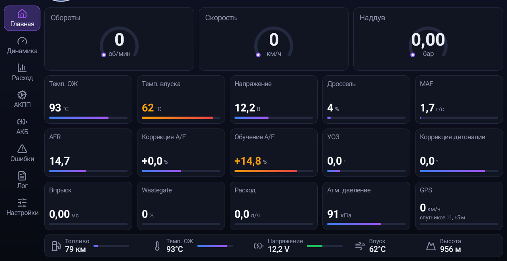
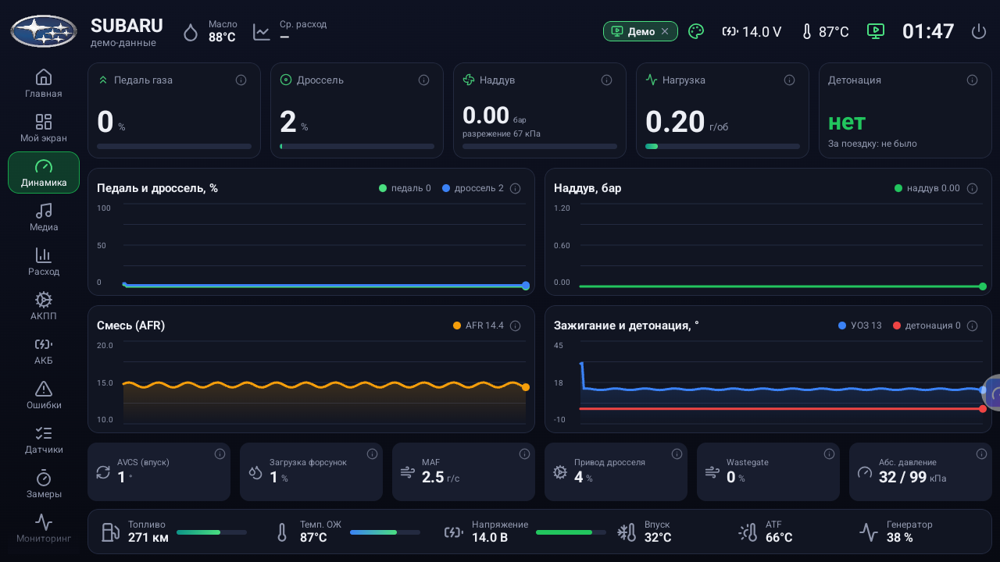
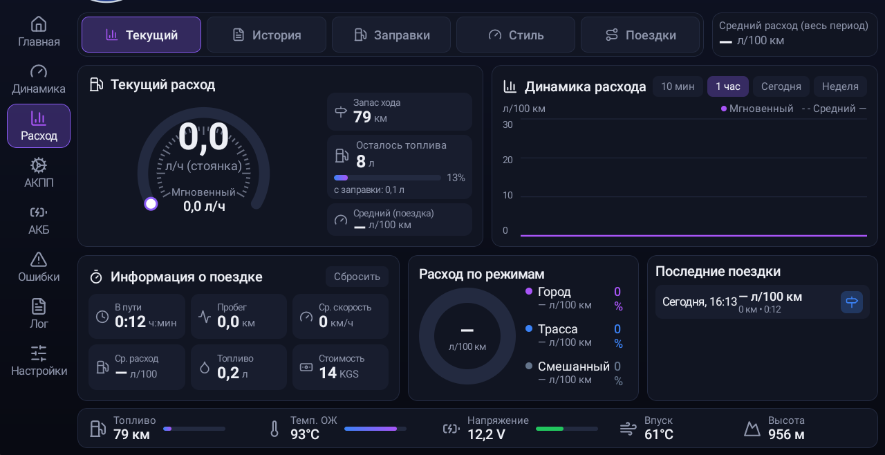
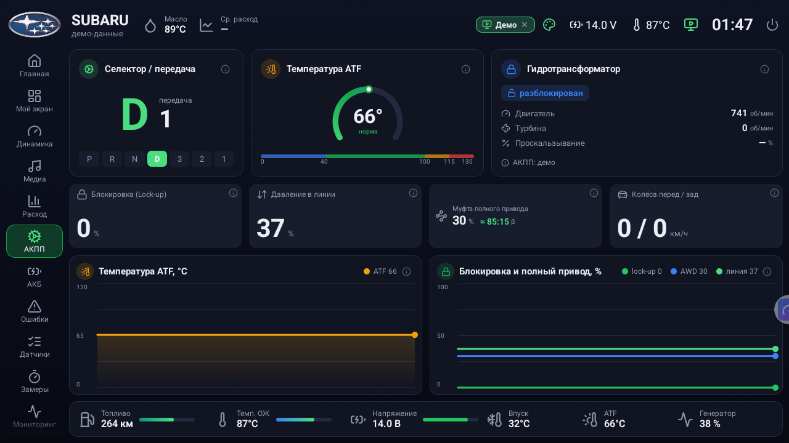
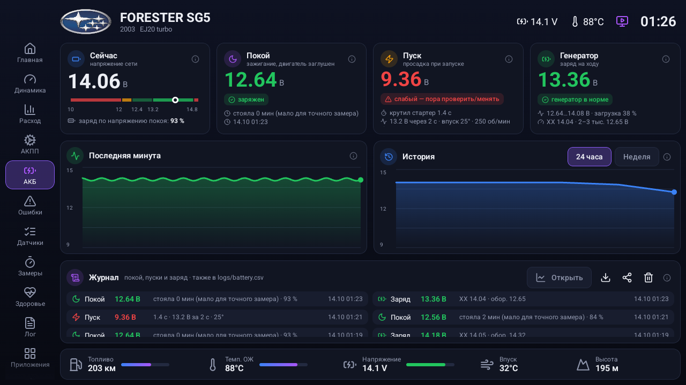
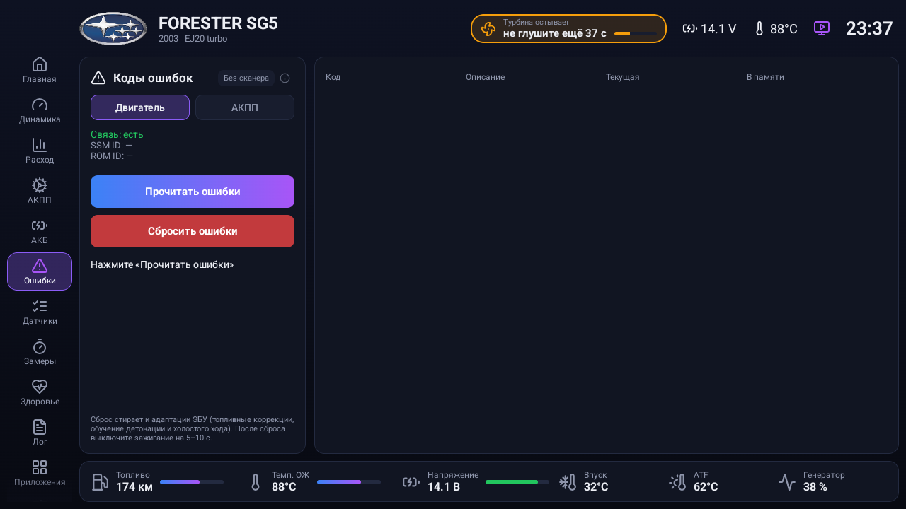

# Subaru SSM Dashboard (K-Line)

> 🧪 **Бета 0.9 — Subaru Dashboard** (Forester SH, OpenPort 2.0, Bluetooth ELM327, свой главный экран, дизайны приборов, телефоны):
> **[⬇️ Скачать бету 0.9-beta10](https://github.com/surtaeff/subaru-ssm-dashboard/releases/download/v0.9-beta10/subaru-ssm-dashboard-0.9-beta10.apk)** · [что нового](https://github.com/surtaeff/subaru-ssm-dashboard/releases/tag/v0.9-beta10) · [исходники](https://github.com/surtaeff/subaru-ssm-dashboard/tree/beta/0.9).
> Бета подписана новым ключом: перед установкой удалите 0.8 (поездки и заправки удалятся).

Приложение для Android-магнитол (Teyes и подобных): бортовой компьютер, приборы, расход топлива, ошибки двигателя и АКПП для Subaru с протоколом **SSM2 по K-Line** через дешёвый **USB KKL-кабель**.

Сделано и проверено на **Subaru Forester SG5 2003 (JDM, EJ20 turbo, 4EAT)** с Android-магнитолой **Teyes CC3** (Android 10, 1280×720), установленной вместо штатной. Должно работать и на других Subaru 2001–2008 с SSM2 по K-Line (Forester SG, Impreza GD/GG, Legacy BE/BH/BL/BP), но там не проверялось.

| Главная | Динамика |
|---|---|
|  |  |
| **Расход** | **АКПП** |
|  |  |
| **Аккумулятор** | **Ошибки** |
|  |  |

## 📥 Скачать APK

**[⬇️ Скачать subaru-ssm-dashboard.apk](https://github.com/surtaeff/subaru-ssm-dashboard/releases/latest/download/subaru-ssm-dashboard.apk)** (последняя версия, собирать ничего не нужно)

Все версии: [Releases](https://github.com/surtaeff/subaru-ssm-dashboard/releases).

**Как установить на магнитолу (без компьютера):**
1. Скачай APK по ссылке выше на телефон или компьютер.
2. Скопируй файл на флешку и вставь её в USB магнитолы. Можно и иначе: открой эту страницу в браузере на самой магнитоле и скачай APK прямо туда.
3. На магнитоле открой «Файлы» (File Manager), найди `subaru-ssm-dashboard.apk` и нажми на него.
4. Если появится «Установка из неизвестных источников запрещена», нажми «Настройки», разреши установку для файлового менеджера (или браузера) и вернись назад.
5. Нажми «Установить», затем «Открыть».
6. Разреши доступ к местоположению.
7. Подключи KKL-кабель (см. ниже). На вопрос «Открыть приложение при подключении USB-устройства?» поставь галочку «по умолчанию» и нажми «ОК».
8. Включи зажигание или заведи двигатель: данные пойдут через пару секунд.

> Обновление: просто установи новый APK поверх старого, данные (поездки, заправки, калибровка) сохранятся.

## Что умеет

**Двигатель (ЭБУ, SSM2-адрес 0x10)**, опрос около 4 раз в секунду:
- обороты, скорость, температура ОЖ и впуска, напряжение бортсети;
- MAF, дроссель, педаль газа, привод электронного дросселя, длительность и загрузка форсунок;
- наддув (абсолютное давление во впуске минус атмосферное), wastegate, AVCS;
- AFR (широкополосный A/F-датчик), краткосрочная и долгосрочная топливная коррекция;
- угол зажигания и откат по детонации (счётчик случаев за сеанс);
- предупреждения цветом: перегрев, низкое напряжение, большие коррекции.

**АКПП (TCU, SSM2-адрес 0x18):**
- положение селектора (P/N, R, D, 3, 2, 1) и текущая передача;
- температура ATF с зонами «холодная / норма / горячая / перегрев»;
- обороты турбины, блокировка гидротрансформатора и проскальзывание;
- давление в линии, муфта полного привода (transfer duty), скорость передних и задних колёс.

**Расход топлива:**
- мгновенный (л/100 км и л/ч), за поездку, за всё время;
- считается по MAF с учётом топливных коррекций и замеренного AFR;
- самокалибровка по заправкам: вводишь только «сколько залил», дата подставляется сама, коэффициент уточняется между заправками до полного бака;
- запас хода, остаток в баке, стоимость поездки;
- график динамики (10 мин, час, сегодня, неделя), расход по режимам (город, трасса, смешанный), история за 30 дней, список поездок, оценка стиля вождения.

**Аккумулятор:**
- напряжение покоя и примерный процент заряда;
- просадка при пуске стартером и длительность пуска;
- напряжение заряда от генератора и загрузка генератора;
- оценки «норма / слабый / недозаряд / перезаряд»;
- история за сутки и неделю, журнал событий (дублируется в `logs/battery.csv`).

**Ошибки:**
- чтение и сброс кодов отдельно для двигателя (387 кодов) и для АКПП (Subaru 2-значные или OBD-II коды, таблица выбирается автоматически по ответу блока);
- текущие ошибки и ошибки в памяти;
- описания кодов на русском, под ними оригинал на английском.

**Кнопки быстрого запуска и разделённый экран:**
- кнопки «Навигатор» и «Музыка» в боковой панели, свои кнопки добавляются в «Настройках» (любое установленное приложение, название, иконка Lucide, режим «рядом» или «весь экран»);
- «рядом»: приложение открывается в левой половине экрана, а Subaru Dashboard справа перестраивается в компактную панель водителя (скорость, обороты, АКПП, наддув, температуры, напряжение, расход);
- кнопка «Весь экран» возвращает полноэкранный режим, навигатор продолжает вести по маршруту в фоне;
- разделённый экран на Teyes открывается через root (Magisk). Без root кнопки просто запускают приложение.

**Голосовой ассистент (офлайн):**
- своё имя ассистента (по умолчанию «Форестер»), команды: кнопки по названию или голосовой фразе, «поехали на …» (поиск в Яндекс Навигаторе), «весь экран», «громче/тише», «следующий/далее/пауза/стоп/играй», открыть экраны («расход», «коробка», «аккумулятор», «ошибки»);
- распознавание Vosk, модель ~45 МБ скачивается один раз; микрофон должен быть свободен (на Teyes отключите Teyes Voice / TXZ).

**Панель навигации** — слева, справа, сверху или снизу (Настройки).

**Главный экран магнитолы:**
- приложение можно назначить домашним экраном вместо лаунчера Teyes (Настройки → «Главный экран магнитолы», нужен root);
- вкладка «Приложения»: все установленные программы, поиск и кнопка «Штатный лаунчер Teyes»;
- после перезагрузки режим восстанавливается скриптом Magisk (`/data/adb/service.d/forester_home.sh`).

**3D-модель Forester SG на главной:**
- 72 кадра поворота на 360° (крутится пальцем, медленный автоповорот, подсветка в такт оборотам), цвет «баклажан-хамелеон»;
- свой номер: Настройки → «Номер на 3D-модели» (текст, флаг KG или своя картинка) — номер накладывается на табличку с перспективой;
- кадры отрендерены скриптом `render/render_turntable.py` (Blender 4.2).

**Медиа (замена виджетов Teyes):**
- штатный плеер: трек, исполнитель, прогресс, управление (данные приходят от плеера, когда приложение — главный экран);
- Bluetooth-музыка и FM-радио через системную службу FYT (`com.syu.ms`): частота, пресет, название станции и логотип из онлайн-списка Teyes (`/sdcard/fmbd`), поиск и пресеты.

**Прочее:**
- GPS: высота, контроль спидометра (коэффициент коррекции учится по GPS), пробег;
- CSV-лог каждой поездки со всеми параметрами;
- автоочистка: подробные логи хранятся 1, 3 или 7 суток, папка не больше 200 МБ, данные графиков сжимаются и хранятся 35 дней;
- фоновый сервис: данные пишутся, даже когда открыт навигатор;
- автостарт при загрузке магнитолы и при подключении кабеля.

## Что нужно

### Магнитола
Android-магнитола (Teyes CC3/CC2/SPRO, FYT/UIS7862 и подобные) или планшет с **USB host**, Android 8.0+ (minSdk 26). Интерфейс рассчитан на экран 1280×720 в горизонтальной ориентации.

Root **не нужен**. Он используется только по желанию: на Teyes CC3 USB-контроллер иногда застревает в режиме device, и с root приложение само возвращает его в host.

### Кабель
Нужен **USB KKL-кабель** (часто продаётся как «VAG-COM KKL 409.1», «USB KKL OBD2»). Это простой USB↔K-Line адаптер **без микроконтроллера ELM**.

Поддерживаемые USB-чипы (через [usb-serial-for-android](https://github.com/mik3y/usb-serial-for-android)):
- **CH340 / CH341** (проверено: `1a86:7523`);
- FTDI FT232;
- Prolific PL2303;
- Silicon Labs CP210x.

❌ **ELM327 (Bluetooth, Wi-Fi, USB) не подойдёт.** Он говорит на своём AT-протоколе и не умеет Subaru SSM2.

### Подключение
- Кабель втыкается в 16-контактный диагностический разъём под рулём; K-Line это **контакт 7**.
- На некоторых машинах есть отдельные зелёные разъёмы «Test mode / Read memory», для SSM они **не нужны**: просто подключи кабель к основному разъёму.
- Параметры линии: 4800 бод, 8N1. Все запросы эхом возвращаются в кабель, приложение это учитывает.

## Сборка из исходников (для разработчиков)
```bash
# JDK 17 + Android SDK (platform 34)
./gradlew assembleDebug
adb install -r app/build/outputs/apk/debug/app-debug.apk
```

## Как это работает
- **Протокол SSM2:** пакет `80 <dest> F0 <len> <cmd…> <checksum>`, где `0xBF` это init (SSM ID, ROM ID, байты возможностей), `0xA8` чтение адресов, `0xB8` запись.
- **Список параметров** проверяется по байтам возможностей ЭБУ. Адреса и формулы взяты из логгер-определений RomRaider и таблиц FreeSSM.
- **Положение селектора АКПП** (байт `0x6B`) определено опытным путём на 4EAT: бит 1 R, бит 2 D, бит 3 «3», бит 4 «2», бит 5 «1», ноль P/N.
- **Уровень топлива** ЭБУ SG5 не передаёт (параметр `0x2E` не поддерживается), поэтому остаток считается от заправок.
- **Сброс ошибок:** запись `0x40` по адресу `0x000060`. Сбрасывает и адаптации (топливные коррекции, обучение детонации и холостого хода, у АКПП обучение переключений). После сброса выключи зажигание на 5–10 секунд.

## Благодарности и источники данных
- [RomRaider](https://www.romraider.com/): логгер-определения SSM (адреса, формулы, коды ошибок), GPL;
- [FreeSSM](https://github.com/Comer352L/FreeSSM): таблицы параметров и ошибок ЭБУ и АКПП, таблица температуры ATF, GPL-3.0;
- [usb-serial-for-android](https://github.com/mik3y/usb-serial-for-android): драйверы USB-serial, MIT;
- [Lucide](https://lucide.dev/) через [composables icons-lucide](https://github.com/composablehorizons/compose-icons): иконки, ISC.

## 3D-модель
Кадры отрендерены из модели [«Subaru Forester MK2 2002-2008»](https://sketchfab.com/3d-models/subaru-forester-mk2-2002-2008-1df01538f1954a5c87adcc4a792a365a) автора **szymonpasterczyk** (Sketchfab), лицензия [CC BY 4.0](https://creativecommons.org/licenses/by/4.0/). Изменения: убраны тюнинг-детали и салон мода, собраны колёса и капот, перекрашено, пустые номерные таблички.

## Лицензия
[GPL-3.0](LICENSE). Таблицы параметров и кодов ошибок получены из проектов под GPL.

## Отказ от ответственности
Проект любительский. Используешь на свой страх и риск. Сброс ошибок стирает адаптации ЭБУ и АКПП. Не отвлекайся на экран за рулём.
